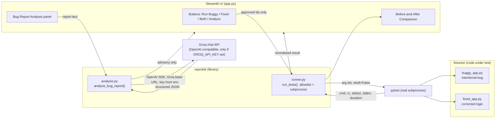

# ReproKit — Evidence-Driven Bug Testing

ReproKit is a small, deliberately bounded tool that **reproduces a bug and
verifies a fix using only real, captured test evidence**. It runs a
known-buggy implementation and a corrected reference implementation through
the *same* controlled test harness, shows the raw evidence side by side, and
optionally asks a large language model (LLM) to analyze a bug report — while
keeping a hard line between **observed evidence** (what pytest actually
produced) and **AI advice** (hypotheses and suggestions that are not proof).

The point is not to test anything, but to demonstrate the discipline:
*never claim a bug is fixed (or even real) without showing the test run that
backed the claim, and never let a model's opinion be mistaken for that
evidence.*

---

## The problem it addresses

When people — or AI agents — debug software, the most common failure mode is
conflating **plausible explanation** with **observed fact**. A model can be
confident that a fix works, and that confidence can be wrong. ReproKit is
built around a simple rule:

> An outcome is only reported as *passed*, *failed*, or *inconclusive* when a
> real pytest run supports it. Anything ambiguous, missing, timed out, or
> errored is **inconclusive**, never a pass.

The dashboard makes that distinction visible: every run displays the exact
command, exit code, duration, stdout, and stderr.

## Who it is for

- **Developers and reviewers** who want a reproducible "before vs. after"
  demonstration for a specific bug.
- **QA / test engineers** exploring how to present test evidence as an
  artifact rather than a screenshot or a claim.
- **Teams building AI-assisted testing tools** who need a clean, safe
  reference for separating *evidence* from *advice* and for running tests
  through an allowlist instead of arbitrary input.

## Workflow

1. **Run the buggy example** — pytest executes the fixture that contains a
   deliberate, deterministic bug. The run **fails**, and the UI labels that
   failure as the expected, reproducible outcome.
2. **Run the fixed example** — pytest executes the corrected implementation.
   The run **passes**.
3. **Run both** — the UI shows a **Before-and-After Comparison** and a
   verdict that is *derived from the runner-returned statuses* (never
   hard-coded). If either run is inconclusive, the comparison is labeled
   inconclusive.
4. **(Optional) Analyze a bug report** — paste a report; if an AI provider is
   configured, the UI asks it for a structured analysis and presents it
   clearly as *advisory, not evidence*.

## Architecture



Two properties are load-bearing:

- **The runner is allowlist-driven.** `run_tests()` accepts only two
  predefined identifiers and maps them to fixed test paths internally. It
  never accepts a command string, file path, or test name from the user, and
  it invokes pytest with an argument list and `shell=False`.
- **The AI path is read-only with respect to the system.** It receives report
  text, returns structured text, and cannot select test IDs, build commands,
  execute code, or modify files. The analysis module does not import the
  runner at all.

## Project layout

```
reprokit/
├── app.py                  # Streamlit entry point (UI only)
├── requirements.txt        # runtime deps
├── pytest.ini              # test config (pythonpath, testpaths)
├── reprokit/
│   ├── __init__.py
│   ├── runner.py           # allowlist-driven, safe test runner
│   ├── logs.py             # redaction, error grouping, bounded AI excerpt
│   ├── magic.py            # Magic Mode: uploads, grounded issues, privacy
│   ├── patch.py            # strict unified-diff validation + temp staging
│   ├── verify.py           # approved static checks + report export
│   ├── analysis.py         # AI analysis (Groq by default) + strict parsers
│   └── studio.py           # corrected copies, test recommendations, fix reports
├── fixtures/
│   ├── buggy_app.py        # is_valid_username() with an intentional bug
│   └── fixed_app.py        # is_valid_input() with the corrected logic
└── tests/
    ├── test_buggy_app.py   # EXPECTS the bug → one test intentionally fails
    ├── test_fixed_app.py   # expects correct behavior → passes
    ├── test_runner.py      # runner safety + parsing (no network)
    ├── test_logs.py        # log parsing/grouping/redaction/limits (offline)
    ├── test_magic.py       # Magic Mode uploads, grounding, privacy filter
    ├── test_patch.py       # diff validation, path safety, staging
    ├── test_verify.py      # approved checks, tamper/stale/timeout, scope
    ├── test_analysis.py    # AI parsing/safety (no live credentials)
    ├── test_studio.py      # corrected copies and reports (offline)
    └── test_app_ui.py      # landing, mode navigation, and review controls
```

## Setup and launch

### Windows PowerShell

```powershell
# 1. From the project root (S:\reprokit)
cd S:\reprokit

# 2. (Recommended) create and activate a virtual environment
python -m venv .venv
.venv\Scripts\Activate.ps1

# 3. Install dependencies
python -m pip install --upgrade pip
python -m pip install -r requirements.txt

# 4. Launch the dashboard
streamlit run app.py
```

The app opens at `http://localhost:8501`.

### Generic Python environment (Linux/macOS)

```bash
cd reprokit
python3 -m venv .venv
source .venv/bin/activate
python -m pip install --upgrade pip
pip install -r requirements.txt
streamlit run app.py
```

`app.py` is the single Streamlit entry point; run it from the project root so
the `reprokit` package and `fixtures` import correctly.

## The predefined examples

ReproKit ships exactly two controlled examples, selected only by the two
approved identifiers. There is no way to point the runner at other code.

- **Buggy example — `buggy_input_validation`** (`fixtures/buggy_app.py`)
  `is_valid_username(value)` is *supposed* to reject empty and whitespace-only
  usernames. The implementation checks `len(value) > 0` without stripping, so
  `"   "` is incorrectly accepted. **Its test suite is expected to fail.**
- **Fixed example — `fixed_input_validation`** (`fixtures/fixed_app.py`)
  `is_valid_input(value)` strips before checking length, so empty and
  whitespace-only input are rejected. **Its test suite is expected to pass.**

### Run Both Examples (comparison)

Clicking **Run Both Examples** runs the buggy suite first, then the fixed
suite, stores both results in session state, and renders them side by side
(status, exit code, duration, relevant output). A summary verdict is computed
**only from the returned statuses**:

- Both match expectations → "outcomes match expectations".
- Any mismatch → an explicit "does not match expectations" error.
- Either run inconclusive or errored → the comparison is **INCONCLUSIVE**.

## AI Bug Report Analysis (optional)

The **Bug Report Analysis** section takes a pasted bug report and — when an AI
provider is configured — requests a *structured* analysis:

- Short problem summary
- Likely cause — **explicitly labeled as a hypothesis, not a confirmed fact**
- Reproduction steps
- Suggested test cases (tagged `normal` / `edge`)
- Missing information / clarifying questions

The UI repeatedly labels this output as **AI-generated advice, not observed
test evidence**, and the captured pytest evidence remains the authoritative
record. The AI output cannot select test IDs, construct commands, execute
code, modify files, or trigger the runner.

### Configuration

Groq is the selected provider. It is reached through the OpenAI Python SDK
pointed at Groq's OpenAI-compatible endpoint
(`https://api.groq.com/openai/v1`). The key is read **only** from the
environment.

| Variable                 | Required | Purpose                                                    |
| ------------------------ | :------: | ---------------------------------------------------------- |
| `GROQ_API_KEY`           | **yes**  | Enables AI analysis. Without it the UI shows a clear "unavailable" state and no call is made. |
| `REPROKIT_AI_MODEL`      | no       | Groq model ID. Defaults to `openai/gpt-oss-120b`.           |
| `REPROKIT_AI_PROVIDER`   | no       | Provider selection. Defaults to `groq`. `openai` is an explicit opt-in only; there is no silent fallback. |

Set them in your shell (PowerShell example):

```powershell
$env:GROQ_API_KEY = "gsk_..."              # required for live AI; do not commit
$env:REPROKIT_AI_MODEL = "openai/gpt-oss-120b"   # optional
```

Other current Groq production models you can set via `REPROKIT_AI_MODEL`
include `openai/gpt-oss-20b` (cheaper/faster), `llama-3.3-70b-versatile`, and
`llama-3.1-8b-instant` — confirm the live list at
<https://console.groq.com/docs/models>.

> **Advisory, not proof.** A model response — even a confident, well-structured
> one — is a hypothesis. It never substitutes for the captured test run. If you
> see a "likely cause" in the analysis, treat it as a starting point to verify
> with the actual test evidence, not a conclusion.

## AI Log Analysis (TraceGuard-style workflow)

Upload a `.log` or `.txt` file (max 2 MB, first 20,000 lines) and ReproKit
produces an evidence-first review:

1. **Redact** — API keys, JWTs, bearer/basic credentials, `password=`/`token=`
   values, emails, home-directory paths, long hex IDs, and card-like numbers
   are replaced with `[REDACTED…]` *before* display or any AI call.
2. **Group deterministically** — exceptions/tracebacks, HTTP 4xx/5xx,
   timeout messages, and `ERROR`/`CRITICAL` lines are grouped by a normalized
   signature, with counts, line ranges, severity, and supporting lines.
3. **Enrich (optional)** — a bounded excerpt (≤ 40 lines / 12,000 chars) of the
   most significant groups is sent to the configured Groq model, which may add
   a **hypothesis** for the cause and **suggested troubleshooting steps**.
4. **Report** — a concise observed-facts incident summary plus per-group
   findings, downloadable as Markdown.

Separation is explicit throughout: supporting log lines are labeled
*observed evidence*, while causes and steps are labeled *AI hypotheses /
suggestions*. AI findings are matched back to observed groups by an exact
`group_key`; unmatched AI output is ignored, so the model can never invent
log evidence or overwrite a severity. Log text is never interpreted as code.

Safety behavior: empty files, oversized uploads, non-UTF-8/binary content, and
files outside `.log`/`.txt` are handled with clear messages; secrets are never
sent to the model. The existing bug-testing demo is unchanged and still works
without any AI key.

## Two modes

The dashboard opens with a **Logic Mode / Magic Mode** switch at the top.

**Logic Mode** (default, unchanged) is the evidence-driven dashboard documented
above: the allowlisted pytest runner, buggy/fixed before-and-after comparison,
AI log analysis, and bug-report analysis.

**Magic Mode** is a universal text-file review workflow for your own files:

- Upload up to 8 source, configuration, log, or text files with the existing
  2 MB per-file / 4 MB total limit. Supported source extensions include Python,
  JavaScript/TypeScript, Java, Kotlin, Go, Ruby, Rust, C/C++, C#, PHP, Swift,
  Scala, Shell, PowerShell, Dart, Lua, Perl, R, Elixir, and Haskell. Supported
  document/data extensions include JSON, YAML, TOML, XML, HTML, CSS, SCSS, Less,
  INI, properties, environment files, CSV/TSV, Markdown, plain text, and logs.
  Unsupported extensions and binary content are rejected with an explicit
  message rather than decoded and analyzed as source.
- Files are stored as **read-only snapshots** with a SHA-256 hash; duplicates and
  unsupported extensions are rejected rather than overwritten.
- **Log files are grouped deterministically** (reusing `reprokit/logs.py`);
  each source/configuration/text file is independently reviewed from a bounded,
  redacted, line-numbered excerpt when an AI provider is configured. Without AI,
  Python AST and JSON/TOML/XML syntax checks still run where supported, and
  INI, and XML syntax checks still run where supported, and uncertain logic
  observations are labelled with their assumptions.
- **Every issue is grounded.** AI-proposed evidence references are resolved
  against the uploaded files; unknown files and out-of-range line numbers are
  discarded, and an issue with no valid evidence is never displayed. The UI shows
  the exact supporting lines (redacted) with `file:line` labels.
- **AI explanations are hypotheses**, labeled as such and shown separately from
  observed evidence. Severity source (`observed` vs `ai`) is shown per issue.
- **Follow-up questions are optional** and never block analysis or proposed
  fixes. Each answer is **Share with AI**,
  **Keep private**, or **Skip**; only explicitly shared, non-empty answers are
  included in later prompts (`MagicSession.shareable_answers()` plus a second
  filter inside `analyze_magic_issues`).
- **Propose fix** requests a structured proposal (explanation, unified diff,
  expected behavior, tests needed, limitations). The diff is validated before
  display: only uploaded code/text files, no absolute paths, `..`, symlinks,
  renames, new/deleted files, binary patches, oversized diffs, or hunks that do
  not apply cleanly to the exact snapshot. Invalid proposals are rejected.
  A narrow, deterministic whitespace-validation correction is generated when
  its explicit behavior assumption is shown; other edits require sufficient
  grounded evidence and a valid AI proposal.
- Valid proposals are labeled **Proposed — not verified** and shown as a
  canonical diff plus before/after views. Staging (optional) copies all uploads
  into a **fresh temporary workspace** and writes patched files only there;
  original uploads are hash-checked and never modified.
- **Verify staged proposal** runs only fixed, approved checks: original upload
  hashes, proposal/staged-byte integrity, workspace contents (no missing, extra,
  or   symlinked files), static Python/JSON/TOML/INI/XML parsing when available, and
  a ReproKit fixture
  regression. Results are `verified_static`, `failed`, or `inconclusive` — never
  an unqualified "verified".
- The fixture check runs **ReproKit's own fixtures** through the allowlisted
  runner. It does **not** exercise the uploaded project, and the UI says so. A
  successful report reads **"Statically verified — runtime behavior NOT
  verified."**
- Every check records its description/command, exit status, duration, bounded
  output, and a UTC timestamp; the report downloads as Markdown. Restaging or
  regenerating a proposal clears previous results.
- The **Evidence-to-Fix Review Studio** creates downloadable corrected copies
  (clean or with explanatory comments), can request one Python/pytest regression
  test recommendation, and exports a Markdown fix report. Generated test code
  is a proposal only and is never executed; originals are never changed.
  Corrected-source downloads preserve the uploaded source so the result remains
  usable; review them for secrets before sharing. In-app source previews and
  downloadable reports redact detected secrets.

## Running the tests

From the project root:

```powershell
# The full suite (includes the intentionally failing buggy fixture)
python -m pytest

# The suite that should be green (everything except the intentional bug)
python -m pytest --ignore=tests/test_buggy_app.py

# Individual suites
python -m pytest tests/test_buggy_app.py    # EXPECTS 1 failure (the intentional bug)
python -m pytest tests/test_fixed_app.py    # passes
python -m pytest tests/test_runner.py       # passes
python -m pytest tests/test_logs.py         # passes (offline log parsing/redaction)
python -m pytest tests/test_magic.py        # passes (offline grounding/privacy)
python -m pytest tests/test_patch.py        # passes (diff validation/staging)
python -m pytest tests/test_verify.py       # passes (approved checks, no execution)
python -m pytest tests/test_analysis.py     # passes (no network / no credentials)
python -m pytest tests/test_studio.py       # passes (corrected copies and reports)
python -m pytest tests/test_app_ui.py       # passes (Streamlit UI workflow)
```

> **Note on the "passing" suite.** `tests/test_buggy_app.py` is written to
> *assert the correct behavior*, so it **intentionally fails** against the
> buggy fixture — that failure *is* the reproduced bug and is the whole point.
> Therefore the **complete** test suite does not pass by design. The
> non-intentional suites (`test_runner.py`, `test_fixed_app.py`,
> `test_logs.py`, `test_analysis.py`) are expected to pass, and
> `test_fixed_app.py` confirms the corrected implementation.

## Safety boundaries

- **Allowlist only.** The runner accepts exactly two identifiers. Arbitrary
  commands, file paths, shell strings, and test names are rejected.
- **No shell.** pytest is launched via `subprocess.run([...], shell=False)`.
- **Fail-closed status.** Timeouts, launch errors, missing summaries, and
  ambiguous output normalize to `inconclusive`, never `passed`.
- **AI is inert.** It cannot drive the runner, pick test IDs, run code, or
  touch files. It is also never called without credentials, and credentials
  are read from the environment (never printed or embedded in prompts).
- **No arbitrary execution.** The app and runner do not execute pasted or
  model-generated code.

## Known limitations (stated honestly)

- **No OS-level sandbox.** Tests run as a normal subprocess with the current
  user's permissions. There is no container, seccomp, or resource isolation.
- **No arbitrary uploaded-project testing.** ReproKit runs only its two
  built-in fixtures. It does not accept or execute user-uploaded projects.
- **No automatic changes to originals.** Fixes remain reviewable proposals;
  corrected downloads and temporary staging workspaces are separate copies.
- **No live AI without credentials.** Without `GROQ_API_KEY`, the analysis
  section shows an unavailable state and performs no network call.
- **Provider coupling.** The AI path uses the OpenAI SDK as a client for
  Groq's OpenAI-compatible API. Selecting a different provider
  (`REPROKIT_AI_PROVIDER=openai`) is explicit; ReproKit never falls back to
  another provider on its own.
- **Pytest environment assumptions.** The runner parses pytest's textual
  summary. Highly customized pytest plugins or output that deviates from the
  standard `... passed/failed in ...s` format may force an `inconclusive`
  result (safe, but less informative).
- **Timeout semantics.** A timeout aborts the pytest process but does not
  kill detached grandchild processes.

## Status of publishing and demoing

Nothing in this project has been published to GitHub, deployed as a public
demo, recorded as a video, or made to make live AI calls. Those are
deliberately **out of scope** for this step and have not been done. Enabling
live AI, packaging for distribution, or publishing are separate follow-up
steps.
